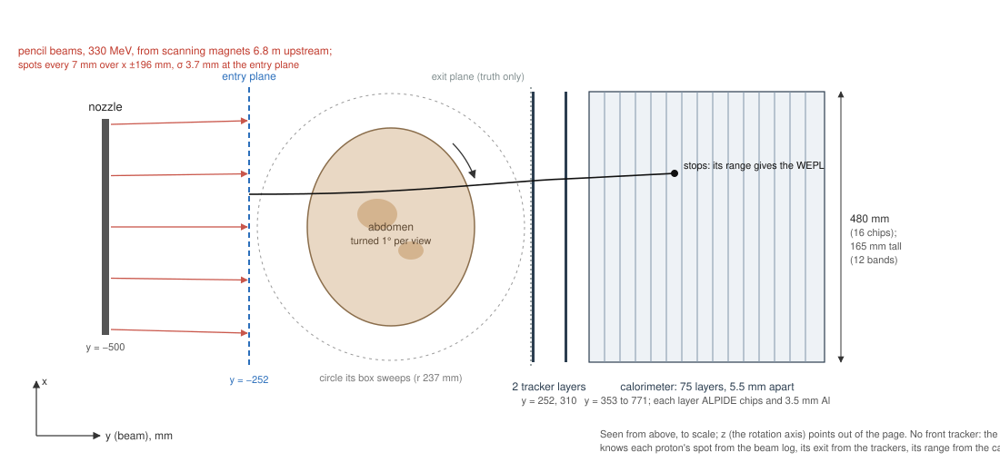
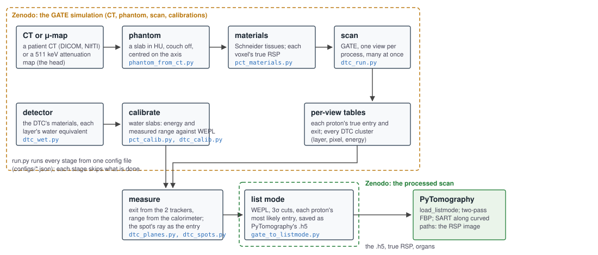

# Proton CT simulation with GATE: from a CT to PyTomography's list mode

Monte Carlo simulations of proton CT scans with a Bergen-type digital tracking calorimeter (DTC), and the conversion of
what the scanner measures into the list mode file that [PyTomography](https://github.com/PyTomography/PyTomography)
reconstructs. One config file sets the phantom, the beam, the detector and the scan; `run.py` runs every stage, from a
patient CT (or an attenuation map) to the `.h5` file.

The published scan, an adult abdomen at 330 MeV without a front tracker:

* the simulation (the CT, the phantom, every proton's truth and every DTC cluster, the calibrations):
  [doi:10.5281/zenodo.23814741](https://doi.org/10.5281/zenodo.23814741)
* the processed scan in PyTomography's list mode format: [doi:10.5281/zenodo.23815070](https://doi.org/10.5281/zenodo.23815070)

## The scanner



* **Beam.** GATE's pencil-beam treatment-plan source with the Bergen beam (Zenodo 7426388; Solie 2020): scanning
  magnets 6780 and 7430 mm upstream, spot σ 3.0 mm and 2.8 mrad at the nozzle, 500 mm before the isocentre; spots 7 mm
  apart, fired in order, so a proton's spot follows from its event number, as a beam delivery log gives it.
* **Phantom.** A CT's own voxels (not resampled), HU to Schneider et al.'s tissue materials, turned about the vertical
  axis in steps (step and shoot).
* **Detector.** Two tracker layers and a calorimeter of layers of ALPIDE chips, 5.5 mm apart, each with 3.5 mm of
  aluminium (Alme et al. 2020; Pettersen et al. 2019); its width, height and depth are inputs. The DTC moves back when
  the phantom's turning box would reach it. Two ideal planes keep the truth: before the phantom, and 3 mm before the
  first tracker.
* **Physics.** GATE 10 (opengate 10.0.3, Geant4 11.3), `QGSP_BIC_EMY`; production cuts 1 mm in the phantom, 0.01 mm in
  the silicon, 1 m elsewhere.

## The stages



| Stage | Script(s) | What it makes |
|---|---|---|
| `phantom` | `phantom_from_ct.py` (a CT, DICOM or NIfTI) or `phantom_from_mumap.py` (a 511 keV μ-map) | the phantom in HU, cropped, couch off, centred on the rotation axis |
| `materials` | `pct_materials.py` | the label image of Schneider materials and each voxel's true RSP (from Geant4's stopping powers) |
| `detector` | `dtc_wet.py` | the DTC's materials: stopping powers, each layer's water-equivalent thickness, a Bragg–Kleeman fit |
| `calibrate` | `pct_calib.py`, `dtc_calib.py` | WEPL calibrations with water slabs: energy at the ideal exit plane, and the range the DTC measures |
| `scan` | `dtc_run.py` (`dtc_scan.py`, `dtc_convert.py`, `dtc_geometry.py`) | one table per view: every proton's true entry and exit, every DTC cluster |
| `measure` | `dtc_planes.py` (`dtc_range.py`), `dtc_spots.py` | what the DTC measures (exit from the trackers, range from the calorimeter); the spot's ray as the entry |
| `listmode` | `gate_to_listmode.py` | WEPL, 3σ cuts, the entries, and PyTomography's list mode `.h5` |

`pct_scan.py` and `pct_run.py` run the same scans with ideal planes and no detector. `dtc_beam_test.py`,
`dtc_beam_check.py` and `dtc_geometry_plots.py` check the beam, the detector's response and its geometry.

## Running it

Two Python environments:

* **GATE**: `pip install opengate==10.0.3 uproot psutil scipy matplotlib` (opengate brings Geant4 and its data).
* **Analysis**: PyTomography 4 (`pip install pytomography`), which brings PyTorch, nibabel, pydicom and h5py.

Name both in the config (`"python": {"gate": ..., "analysis": ...}`), put the input in `data/`, and run:

```bash
python run.py tests/smoke_abdomen.json            # every stage in about 10 minutes: 2 views of 21 spots
python run.py configs/abdomen330.json             # the published scan: about 9 h on 20 cores, 106 GB
python run.py configs/abdomen330.json listmode    # one stage
```

Inputs: for the abdomen, unzip `ct_PSMA_28f9ecc106933531_dicom.zip` from the
[GATE record](https://doi.org/10.5281/zenodo.23814741) into `data/` (the patient's CT series as TCIA distributes it);
for the head, `fdg_pet_phantom_umap.nii.gz` from [Zenodo 8045458](https://doi.org/10.5281/zenodo.8045458). A stage is
skipped when its output exists, and the scan and the calibrations carry on where they stopped, so a run can be stopped
and started again. Each GATE process takes about 0.6 GB and runs at below-normal priority with one BLAS thread; a view
is started only while the machine keeps 10 GB of RAM and commit free (`PCTSIM_FLOOR_GB` changes it).

## The config

| Key | Meaning |
|---|---|
| `name`, `out` | the scan's name and its output folder (relative to the config file) |
| `python.gate`, `python.analysis` | the two environments' Python |
| `workers` | GATE processes at once |
| `phantom` | `{"from": "ct", "ct": PATH, "slices": [K0, K1]}` (native slices K0 to K1 − 1), or `"around": [MASKS], "margin": MM`; or `{"from": "mumap", "mumap": PATH, "voxel": MM}` |
| `beam` | `energy` (MeV), `x_half` (the spot grid's half-width, mm), `z_centre`, `z_half` (its vertical centre and half-height, mm) |
| `scan` | `views` (over 360°), `protons_per_view`, `seed` (view v uses seed + v) |
| `detector` | `layers` (2 trackers + calorimeter), `chips` (30 mm each, across), `bands` (13.76 mm each, up) |
| `calibration` | `protons_per_thickness`, `max_thickness` (mm of water, every 10 mm) |
| `entries` | `{"mode": "tracker"}` (the true entry, as a front tracker measures it), `"spot"` (the spot's ray, `spot_sd` mm, `divergence` rad/mm) or `"likely"` (the spot combined with the exit traced back: also `exit_angle_sd` rad and `scale`) |

`configs/abdomen330.json` is the published scan. Its entry model (spot σ 3.69 mm, 0.763 mrad/mm, an exit-angle error of
1.34 mrad, Highland's spread × 0.887) was fitted on that simulation's true entries; a different beam, detector or
phantom needs its own fit, so `configs/head230.json` (the head at 230 MeV on Bergen's 41-layer DTC, not yet run in full)
uses `tracker` entries.

## Checks

* `phantom_from_ct.py` rebuilds the published abdomen exactly from the DICOM series in the GATE record and from the NIfTI
  the run used: the same HU in all 370 × 314 × 57 voxels, the same origin, the same organ masks.
* `tests/smoke_abdomen.json` and `tests/smoke_head.json` run every stage on 2 views; `tests/test_gate_to_listmode.py`
  checks the reader's cuts and WEPL and the most likely entries (`python -m pytest tests`).

## Licence and data

The code is MIT licensed (`LICENSE`). The abdomen comes from The Cancer Imaging Archive's PSMA-PET-CT-Lesions
collection (CC BY 4.0; [doi:10.7937/r7ep-3x37](https://doi.org/10.7937/r7ep-3x37)); the head from Belzunce's BigBrain
FDG phantom (CC BY 4.0; [doi:10.5281/zenodo.8045458](https://doi.org/10.5281/zenodo.8045458)). Cite them, and the
records above, when you use the data.
